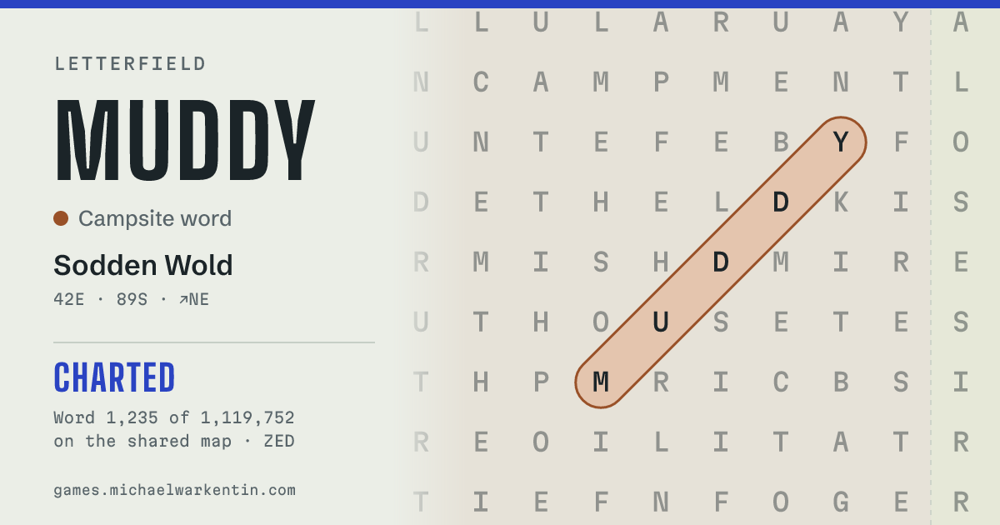

# Link previews for shared Letterfield links

Research notes, November 2026. Nothing here is built yet. The prototype that
backs up the numbers is in [`prototypes/share-card/`](../prototypes/share-card/),
apart from the site and the real Worker.

## Recommendation

**Yes, it's worth doing, and it can be small.** Shares would link to a short
address the Worker answers, like `https://share.michaelwarkentin.com/f/f-muddy-42-89-7`.
That address returns a tiny page whose `og:image` is a card the Worker draws,
and the page sends people straight on to `/letterfield#f-muddy-42-89-7`.

- **Draw an SVG by hand, render it with `@resvg/resvg-wasm`.** The pictures
  are absolute-positioned shapes and text, so a layout engine like satori adds
  size and gives nothing back. Porting `findImage()` to SVG took about 150
  lines. Each card renders in **40–60 ms** of CPU and comes out at **~100 KB**,
  under WhatsApp's ~300 KB limit.
  
- **Give it a Worker of its own (`games-share`)**, not a route on
  `games-leaderboard`. The renderer adds 2.6 MiB of wasm and fonts. Kept
  apart, the leaderboard, War's rooms and the survey stay small and stay free
  of npm dependencies, and a bad renderer deploy can't touch them. It imports
  the same `worker/src/letterfield-world.js` and binds `LOG_DB` read-only.
- **Use a custom domain, `share.michaelwarkentin.com`,** if the zone's DNS is
  on Cloudflare. The Cache API only works reliably on custom domains, and
  `mwarkentin.workers.dev` reads as spam in a chat. Don't put
  games.michaelwarkentin.com behind Cloudflare for this.
- **Every client gets the same `200` page**, with the tags, a
  `<meta http-equiv="refresh">` and `location.replace()`. Don't redirect by
  user agent.
- **Cache each card in the Cache API, backed by R2.** A card for a given
  word on a given map never changes, apart from "charted". It costs nothing
  noticeable on Workers Paid, which the account already has.
- **Start with finds; do survey-log views second.** Finds are deterministic
  and checkable, and they're the shares people will make most. Log views
  change over time and need cache rules per period.

## Contents

1. [How it would work](#how-it-would-work)
2. [Rendering a PNG in a Worker](#rendering-a-png-in-a-worker)
3. [Caching](#caching)
4. [How unfurlers fetch](#how-unfurlers-fetch)
5. [The links' address](#the-links-address)
6. [Abuse and privacy](#abuse-and-privacy)
7. [Changes in this repo](#changes-in-this-repo)
8. [Implementation plan](#implementation-plan)
9. [Open decisions](#open-decisions)
10. [Sources and gaps](#sources-and-gaps)

## How it would work

```
player taps Share on CORAL
  → share sheet gets: text, the picture file (as today), and
    url = https://share.michaelwarkentin.com/f/f-coral-120-m48-2

unfurler (Slackbot, iMessage on the sender's phone, WhatsApp, …)
  GET /f/f-coral-120-m48-2           → 200, small HTML: og:title, og:description,
                                        og:image = …/f/f-coral-120-m48-2.png, og:url = itself
  GET /f/f-coral-120-m48-2.png       → Cache API → R2 → render (resvg) → store

person taps the card
  GET /f/f-coral-120-m48-2           → same 200 page; meta refresh / location.replace
  → https://games.michaelwarkentin.com/letterfield#f-coral-120-m48-2
```

The slug is the game's own fragment (`hashOf()` in `letterfield.html`), so a
share link goes to the same place as today's links. The Worker checks it the
way the survey checks a claim (`checkClaim()` in `worker/src/survey.js`): the
word is in the vocabulary, its letters are on the map there, and it's either
a placed word or a stray of `STRAY_MIN`+ letters. It draws nothing else.

**What the card can say.** The Worker knows everything the map knows: the
word, its theme, the territory's name, the coordinates, whether it's a stray.
For "charted first", it looks the word up in the survey log. The
`survey_log_by_territory (rx, ry, at)` index already narrows a query on
`rx = ? AND ry = ? AND key = ?` to one territory's few hundred rows, so no new
index or extra row writes are needed. It can't honestly show the sharer's own
"word 312 in my field notes": that's only in their browser, and putting it in
the URL would let anyone forge it. The picture file in the share sheet keeps
showing it, as it does on #51.

## Rendering a PNG in a Worker

| Option | Size added to the Worker | CPU per card | Fonts | Fit here |
| --- | --- | --- | --- | --- |
| **Hand-written SVG + `@resvg/resvg-wasm`** (prototyped) | 2.4 MiB wasm + fonts (measured: whole bundle 3.0 MiB, 1.26 MiB gzipped) | **40–60 ms** warm, 130–180 ms on a cold isolate (measured) | TTF/OTF buffers passed in; no WOFF2 | **Best.** One dependency, our own drawing code, no layout engine |
| satori + resvg-wasm (`@cf-wasm/og`, `workers-og`) | the above plus satori and yoga, roughly 0.5–1 MiB more (not measured) | more than the above: layout, then text to paths, then raster | TTF/OTF/WOFF only | Good when cards are JSX layouts. Ours are absolute drawings, so it's extra weight for nothing. `workers-og` is 0.0.x |
| Cloudflare Browser Rendering (Puppeteer screenshots `findImage()` itself) | small; a binding | seconds of browser time per card, billed per browser-hour | the page's own | Keeps one drawing, but it's slow, costly per miss and the most moving parts. A fallback if keeping two drawings in step hurts |
| Cloudflare Images / `@cf/...` AI models | none | n/a | n/a | Images resizes and overlays existing images but can't draw text or shapes, and AI image models make pictures, not exact maps. No |
| Hand-written PNG encoder | tiny (zlib via `CompressionStream`) | fast for shapes | would need a glyph rasterizer | Text is the hard part: rasterizing TrueType by hand is a project of its own. No |
| SVG as `og:image` | none | ~1 ms (measured: SVG built in 0.5–2 ms) | the viewer's | Unfurlers don't accept it: write-ups report Discord, Mastodon and iMessage show nothing, and Slack, WhatsApp and X want PNG, JPEG (or GIF/WebP). No |

**Limits** (Cloudflare's limits page, read November 2026): Workers allow
64 MiB uncompressed on both plans, with no separate compressed limit, a 1 s
startup budget and 128 MB of memory per isolate. The prototype's 3 MiB is far
inside that. resvg compiles its wasm on first use, not at startup. One
1200×630 pixmap is ~3 MB of memory. **CPU is the limit that matters: the free
plan's 10 ms per request can't render a card.** Workers Paid allows 30 s by
default, so 60 ms is fine.

**Fonts.** Big Shoulders Display, Martian Mono and Schibsted Grotesk are all
SIL Open Font License 1.1 (checked in google/fonts' `ofl/*/OFL.txt`). The OFL
allows bundling and embedding them in software, including a Worker, as long
as the fonts aren't sold on their own and the licence goes with them. Ship
each `OFL.txt` next to the TTFs. The five weights the cards use come to
350 KiB as TTF. Subsetting them to ASCII plus arrows (`pyftsubset`) would cut
that to around 100 KiB and speed up font parsing, which resvg does on every
render. The prototype passes all five fonts in on each render.

Things the prototype ran into:

- **resvg 2.6 sets a whole `<text>` in the wrong face** if one `<tspan>`
  changes font. Put each run of one font in its own `<text>`.
- **Martian Mono has no diagonal arrows** (↘ ↙ ↖ ↗). The prototype sets the
  arrow in Schibsted Grotesk. The canvas version falls back silently, so
  phones may show a different arrow today.
- **There's no `measureText`** in a Worker. A 5 KB table of each font's advance
  widths (`src/metrics.json`, made from the TTFs) fits text as `fit()` does on
  the canvas, exactly for the monospaced font and closely, without kerning,
  for the others.
- **Two drawings of the same card** (canvas in the page, SVG in the Worker)
  will drift. Either accept that the link card and the shared file differ a
  little, or later have the page use the Worker's PNG as its file (see
  "Later" in the plan).

**What adding a dependency means.** `worker/package.json` has none today, and
the deploy runs `npx wrangler` straight away. With a separate `share/` Worker,
that stays true for `worker/`. `share/` gets its own `package.json` and
`package-lock.json`, pinned to an exact version. Its deploy workflow and the
test job each add `npm ci` (about 1 MB), and updates come by hand or through
Dependabot. If the renderer went into `worker/` instead, every deploy, test
run and Worker Preview of the leaderboard would pick that up, plus 2.6 MiB on
every cold start of the isolate that holds War's sockets.

## Caching

A find's card is a pure function of (map version, word, x, y, d, charted by
whom, and when). That makes caching easy, and a wrong cache can only ever
mean stale "charted" details.

| Layer | What it does | Cost |
| --- | --- | --- |
| Cache API (`caches.default`) | Answers repeat requests in the same data centre in ~5 ms (measured under `wrangler dev`: 150 ms miss, 4–8 ms hit). It's **per data centre**, not global, and Cloudflare's docs say only Workers on custom domains get working cache operations | free; the request still counts as a Worker request |
| R2 bucket `games-share-cards`, key `m<MAP_VERSION>/<slug>[~charted].png` | Renders each card once, worldwide. A card for a word nobody has charted yet is keyed without the suffix, so charting it later gives a new key. Old maps' prefixes can go with a lifecycle rule | **Free tier:** 10 GB-month, 1 M writes and 10 M reads a month. 100 KB a card is 100,000 cards in 10 GB. Past that, $0.015/GB-month, $4.50 a million writes, $0.36 a million reads |
| `Cache-Control` on the PNG | `public, max-age=604800, immutable` for charted or settled cards, a day for uncharted ones. Unfurlers mostly keep their own copy anyway | free |
| KV | Would also work, but writes are 10× R2's price ($5 a million) and it's capped at 1,000 writes a day on the free plan | not needed |

**What it costs on Workers Paid** (already paid for the survey): requests are
$0.30 a million past the included 10 M a month, and CPU is $0.02 a million ms
past the included 30 M. Rendering 10,000 new cards a month is 0.5 M CPU-ms,
which stays inside what's included. Even **a million new cards** would be
50 M CPU-ms (about $0.40 over), plus about $4.50 of R2 writes. Unfurls of
cards already drawn cost only the request. **On the free plan** it wouldn't
work at all: 10 ms of CPU can't render one card, and every request would come
out of the account's shared 100,000 a day.

The page itself (the HTML) needs no storage: building it is just string work
on the map, well under 1 ms. Send it with `Cache-Control: public, max-age=86400`.

## How unfurlers fetch

None of them run JavaScript. All read `og:*` tags, and X also reads
`twitter:*`, falling back to `og:*`. Most of this table comes from search
results and developers' write-ups rather than each platform's own docs (see
[Sources and gaps](#sources-and-gaps)), so step 7 of the plan checks it with
real shares.

| Client | Who fetches | User agent (contains) | Redirects | Image |
| --- | --- | --- | --- | --- |
| Slack | Slack's servers, once per URL per workspace for a while; images go through Slack's image proxy | `Slackbot-LinkExpanding 1.0` | follows HTTP redirects and reads the final page's tags (limit not documented) | PNG/JPEG/GIF; no documented size limit |
| iMessage | **the sender's device**, before sending; the preview travels as an attachment | `… Safari/601.2.4 facebookexternalhit/1.1 Facebot Twitterbot/1.0` (a Safari UA with bot tokens) | Apple's write-ups and tests: follows HTTP redirects, not meta refresh. Apple asks sites not to vary content by user agent | `og:image`, PNG/JPEG |
| WhatsApp | the sender's app, sometimes Meta's crawlers too | `WhatsApp/2.x` and also `facebookexternalhit/1.1` / `Facebot` | follows HTTP redirects; Meta's crawler also re-fetches `og:url` if it differs | **about 300 KB at most**, or no image (widely reported; Meta's own figure not found) |
| Discord | Discord's servers | `Discordbot` | Discord's docs: up to 5 redirects; at most 50 MB fetched | PNG/JPEG/GIF/WebP; uses `og:image` or `twitter:image`; `theme-color` colours the embed |
| Bluesky | the app, through `cardyb.bsky.app`, while the post is written; the image is then **uploaded to the poster's account as a blob** | cardyb's | follows redirects | the thumbnail is capped at 1,000,000 bytes and resized by the app. Later changes never reach posted cards |
| Mastodon | **every instance that receives the post**, each on its own: one share can mean hundreds or a thousand fetches within a minute | `http.rb/x (Mastodon/x; +https://<instance>/)` | follows redirects | PNG/JPEG/GIF/WebP |
| X | X's servers | `Twitterbot` | follows redirects; honours `robots.txt` | `summary_large_image`; under 5 MB; PNG/JPEG/WebP/GIF; at least 300×157 |

What follows for the design:

- **Serve the same `200` to everyone.** Redirecting by user agent ("bots get
  the page, people get a 302") is fragile. iMessage's UA looks like Safari,
  new crawlers appear all the time, and Apple asks sites not to. A 302 for
  everyone doesn't work either: unfurlers follow it and read Letterfield's
  generic tags. A meta refresh and `location.replace()` are invisible to
  unfurlers and instant for people. Both keep the `#f-…` fragment, and
  `location.replace` keeps the share page out of the back history.
- **`og:url` must be the share URL itself.** Pointing it at the game would
  send Meta's crawler, and so WhatsApp, back to the generic page. Don't add
  `<link rel="canonical">` to the game page either, for the same reason.
- **Keep the PNG under 300 KB** (the prototype's are 95–110 KB) and send
  `og:image:width`/`height`, so clients can lay out the card before the
  image arrives.
- **Mastodon's stampede is why the cache matters.** All of those fetches come
  within a minute and from many data centres. R2 makes it one render.
- **Unfurls are snapshots.** Bluesky stores the image, and Slack, iMessage
  and WhatsApp keep theirs. A card drawn before a word is charted keeps
  saying so wherever it was already shown. That's fine; just don't promise
  live cards.

## The links' address

| | `games-share.mwarkentin.workers.dev` | a route on `games.michaelwarkentin.com/s/*` | **`share.michaelwarkentin.com`** (custom domain) |
| --- | --- | --- | --- |
| What changes in mwarkentin/infra | nothing (workers.dev is on) | games.michaelwarkentin.com's DNS record goes from DNS-only to proxied in front of GitHub Pages, plus a Worker route | a `cloudflare_workers_custom_domain` (or a `custom_domain = true` route in `share/wrangler.toml`) for a hostname in a zone already on Cloudflare; Cloudflare makes the DNS record and certificate |
| Effect on the live site | none | **every page** now goes through Cloudflare. GitHub Pages' certificate renewals need care (Pages checks its own DNS), and Cloudflare's cache and SSL settings now sit in front of the site | none |
| Cache API | unreliable: Cloudflare's docs say cache operations only work on custom domains (SURVEY.md saw the log's cache shared across this account's workers.dev Workers, so it may work, but it isn't promised) | works | works |
| How the link looks in a chat | `mwarkentin.workers.dev` reads as a throwaway host | best: the site's own | good: the owner's domain |
| Previews | Worker Previews are on workers.dev anyway | | Worker Previews are on workers.dev anyway |

**Recommended: `share.michaelwarkentin.com`**, if michaelwarkentin.com's DNS
is on Cloudflare (the infra repo isn't attached here, so I couldn't check).
If it isn't, start on workers.dev with R2 as the cache. That works without
the Cache API, and moving to a domain later only changes `SHARE_URL`.
Proxying games.michaelwarkentin.com would give the nicest links, but it puts
the whole site behind a new layer for one feature.

Changes in mwarkentin/infra, in outline:

- an R2 bucket `games-share-cards`, with a lifecycle rule to expire old maps'
  prefixes if wanted;
- the custom domain for the `games-share` Worker;
- the existing deploy token allowed to deploy the new Worker, write that
  bucket and (if `wrangler.toml` declares the domain) edit Workers routes on
  the zone;
- D1 needs nothing new: a second Worker can bind `games-survey-log` with the
  same database id.

## Abuse and privacy

**What it serves.** Only cards the Worker draws itself from the map and the
log. There are no uploads, no text from the URL in the image beyond a word
that is checked to be really there, and no fetches of other sites. The page
has no query parameters and no open redirect: it always sends people to
`SITE_URL` (a variable) plus the checked slug.

**Cost attacks.** There are a lot of valid slugs: 1.12 M hidden words in the
shared world, plus strays anywhere on a ±1e9 map. So someone could ask for
cards that were never shared. Each costs ~50 ms of CPU and, if kept, an R2
write. That's about $0.40 plus $4.50 a million, which is annoying but not
dangerous. To keep it boring:

- a `ratelimits` binding on **renders only** (cache hits are free to serve),
  for example 30 a minute per hashed address, salted as the survey's are.
  Mastodon's fetches come from many addresses, so they don't hit it;
- keep strays and words outside the shared world in the Cache API only, not
  in R2;
- an Atlas-style daily counter is not needed at these sizes.

**What a share link reveals.** It reveals the word and its coordinates, as
`#f-` links already do. The card adds what the public survey log already
shows: the territory, and the initials of whoever charted the word first.
Those may not be the sharer's; the card says "charted by ZED", not "by me".
Don't put the sharer's initials or field-notes count in the URL.

**What the Worker sees.** iMessage and WhatsApp fetch from the **sender's
phone**, so the share Worker gets the sender's IP address and a UA. Keep
`invocation_logs = false`, as in `worker/wrangler.toml`, keep only salted
hashes for rate limits, and never log slugs with addresses.

**Analytics.** Counterscale stays page views only, on the site. The share
page needs no tracker: when it hands off with `location.replace`, the
browser sends its origin as the referrer, and `analytics.js` records exactly
that. Opens from shares then show up in Counterscale as visits from
`share.michaelwarkentin.com`, with no new code. Unfurls themselves aren't
page views. If counts of unfurls are wanted, a Workers Analytics Engine data
point per render (slug only) is free at this size. Don't add Counterscale to
the share page: it would count every bot.

## Changes in this repo

**`share/` (new Worker).** `src/index.js` (routes), `src/card.js` (the SVG
drawing, from the prototype), `src/metrics.json`, `fonts/` (subset TTFs plus
`OFL.txt`), `wrangler.toml` (R2, `LOG_DB` read-only, ratelimit, custom
domain, `SITE_URL` var, `[previews]` equivalents), `package.json` and a
lockfile. It imports `../worker/src/letterfield-world.js` and `checkClaim`,
so the map is never copied a third time.

**Pages.**

- `letterfield.html`: a `SHARE_URL` constant, empty until it's switched on,
  with a `?share=<url>` override for tests, as `LEADERBOARD_URL` has.
  `shareUrl(e)` returns `${SHARE_URL}/f/${hashOf(e)}` when it's set, else the
  current fragment link. The text, the clipboard fallback and the picture
  file don't change. The game keeps reading `#f-…` exactly as now.
- `letterfield-log.html` (phase 2): the Share button hands out
  `${SHARE_URL}/v/<kind>/<key>/<period>/<start>`, with the period pinned to
  its start rather than "this week", so a card shared on Monday still matches
  its link on Friday. The word links inside the log stay as they are.
- **Offline:** building the URL is string work, so Share still works offline
  and hands out the share link. The card appears whenever the recipient's app
  unfurls it. **`sw.js` needs no change:** it only answers same-origin pages,
  music and Google Fonts, and the share host is another origin. The share
  page can't work offline, but people only reach it from a chat, online, and
  it hands off to the game right away.
- `changelog/letterfield.md`: "Shared finds show their own picture in chats",
  on the day it's switched on.

**Build and previews.**

- `scripts/common.py`: `SHARE_URL` next to `WORKER_URL`.
- `scripts/point_preview.py`: point the pages' `SHARE_URL` at the share
  Worker's Preview when there is one, as it does for `LEADERBOARD_URL`.
- `.github/workflows/preview.yml`: when `share/` (or `worker/src/letterfield-world.js`)
  changes, or the `worker-preview` label is set, make a Worker Preview of
  `games-share` too, with `--var SITE_URL=<the site preview's URL>`, so its
  pages send people to the preview, not production. Its R2 binding goes to a
  previews bucket and `LOG_DB` to the previews' log database, as the
  leaderboard's Previews do. Without a share Preview, previews hand out
  production's share links, which send people to production. That's harmless,
  but confusing, so blank `SHARE_URL` instead, as for the other URLs.
- `.github/workflows/share.yml`: a deploy like `leaderboard.yml`, plus
  `npm ci`, run on pushes to `main` that touch `share/` or `letterfield-world.js`.
- `AGENTS.md`: a "Share cards" section (what `SHARE_URL` does, how to test),
  the new Worker in Layout, and the Link previews section pointing to it.
  `share/README.md` for setup.

**Tests.**

- `share/test/*.test.js` with `node --test`, as `worker/test/` does. They
  cover the routes (a valid slug gives 200 with the right `og:*` tags and
  `og:url` equal to itself; a wrong letter, unknown word, short stray or bad
  slug gives 404), the redirect target (always `SITE_URL`, fragment kept),
  the SVG (snapshot of a known word; text fits in its box using
  `metrics.json`), and one real render through resvg-wasm checking the PNG
  signature, 1200×630, under 300 KB and under, say, 200 ms. The cache path
  can use a small fake R2 and `caches`. The CI test job runs `npm ci` in
  `share/` first.
- A drift check: draw the same find with `findImage()` in Playwright and with
  the Worker's SVG, and compare only the text (word, theme, place,
  coordinates), not pixels.
- `tests/test_letterfield_share.py`: with `?share=https://share.test`, Share
  hands out `https://share.test/f/f-<word>-…` (via a stubbed
  `navigator.share` and the clipboard). Without it, it hands out today's
  fragment link. `without_worker()` also blanks `SHARE_URL`.
  `tests/test_games.py`'s smoke tests need nothing: the page makes no request
  to the share host.

## Implementation plan

Sizes are rough: S is under a day, M a day or two.

1. **Decide** the domain, the plan and the dependency (see below). *(owner)*
2. **infra:** R2 buckets (production and previews), custom domain, token
   scopes. **S** *(mwarkentin/infra)*
3. **`share/` Worker, finds only:** routes, `card.js` from the prototype
   with subset fonts and licences, R2 and Cache API layers, render rate
   limit, "charted by" lookup in `LOG_DB`, graceful fallback (a slug that
   doesn't check out still gets a 200 page with Letterfield's generic tags
   and sends people to `/letterfield`, so links survive a new map). Plus
   `node --test` tests. **M**, ~400 lines plus tests
4. **Deploy workflow** (`share.yml`) and test-job changes. **S**
5. **Preview workflow:** Worker Preview of `games-share`, `SITE_URL` var,
   `point_preview.py`. **S–M** (the existing workflow is long and careful)
6. **Pages:** `SHARE_URL` in `letterfield.html`, the `?share=` override, a
   Playwright test, the AGENTS.md section. Merge with `SHARE_URL` empty. **S**
7. **Try it** on the PR preview in Slack, iMessage, WhatsApp, Discord,
   Bluesky and Mastodon, using each one's card debugger where there is one.
   Then set `SHARE_URL` and add the changelog line on that day. **S**
8. **Phase 2, log views:** `/v/surveyor|theme|territory/...` drawn from
   `shareImage()`'s layout and the log's own queries (import
   `survey-log.js`'s query functions with the `LOG_DB` binding). A running
   period is cached for 15 minutes, a settled one for good, following the
   log's own `SETTLED_MS` rule. Then the log page's Share. **M**
9. **Later, maybe:** have the page fetch the Worker's PNG for its share-sheet
   file when online (and keep the canvas for offline), so there's one drawing
   to keep up. Safari won't open the share sheet after a wait, though, so
   this needs a prefetch when the find's card opens. Dark-mode cards
   (`?dark` in the key), if wanted.

## Open decisions

1. **Domain:** `share.michaelwarkentin.com` (recommended; needs the zone on
   Cloudflare), workers.dev (works now, looks worse, Cache API not
   promised), or proxying games.michaelwarkentin.com (best links, biggest
   change). Another name, like `lf.michaelwarkentin.com` or a short domain of
   its own, works the same way.
2. **Cost:** stays on Workers Paid (required: the free plan's 10 ms CPU
   can't render). R2 is expected to stay inside its free tier. Is a render
   rate limit of ~30 a minute per address the right trade?
3. **Dependencies:** accept `@resvg/resvg-wasm` (one package, no transitive
   dependencies, pinned, MPL-2.0) in a separate `share/` Worker? The
   alternative that avoids npm is vendoring its 2.4 MiB wasm into the repo,
   which is worse to update.
4. **One Worker or two:** two is recommended (see above). One avoids a
   second deploy, Preview and set of bindings, at the cost of a 3 MiB
   leaderboard Worker with a dependency.
5. **What the card shows** for a word nobody has charted yet ("Find it on
   the map", as in the prototype) and for a charted one ("Charted by ZED · 9
   Nov 2026"), and whether to show first charters' initials at all on a
   picture that travels further than the log page.
6. **Light only, or a dark card too.** Link cards are usually shown on a
   light or dark chat background the sender doesn't control. The prototype
   draws the light one.

## Sources and gaps

Measured here: bundle sizes (`wrangler deploy --dry-run` with wrangler
4.151.0), render times (Node 22 and `wrangler dev`, resvg-wasm 2.6.2), PNG
sizes, the font licences (google/fonts `ofl/*/OFL.txt`), and the Cache API
hit and miss under `wrangler dev`. Nothing was deployed.

Read: Cloudflare's [Workers limits](https://developers.cloudflare.com/workers/platform/limits/),
[pricing](https://developers.cloudflare.com/workers/platform/pricing/) and
[Cache API](https://developers.cloudflare.com/workers/runtime-apis/cache/)
pages; [Slack's robots page](https://api.slack.com/robots); Apple's
[link preview best practices](https://developer.apple.com/library/archive/technotes/tn2444/_index.html)
(only its title came through); Meta's
[WhatsApp link previews](https://developers.facebook.com/documentation/business-messaging/whatsapp/link-previews/)
(user agent); Discord's
[link preview docs](https://docs.discord.com/developers/link-previews/overview),
seen only in search results; the Mastodon
[per-instance preview](https://gist.github.com/renchap/3ae0df45b7b4534f98a8055d91d52186)
discussion; and Bluesky's `app.bsky.embed.external`
thumbnail limit, as reported in search results (Bluesky's own docs weren't
read).

Gaps to check by hand in step 7:

- `blog.cloudflare.com` and `docs.discord.com` were blocked by this session's
  network policy, so I couldn't read Cloudflare's newer "Workers Caching"
  (whether it works on workers.dev) or Discord's page in full.
- No official figures turned up for Slack's image size limit or WhatsApp's
  (300 KB is widely reported but not from Meta), or for whether Slack and X
  ever follow meta refresh. They aren't known to, and the design doesn't
  depend on it.
- Browser Rendering's current price wasn't checked, since it isn't
  recommended.
- satori-based bundle sizes were estimated, not measured.
